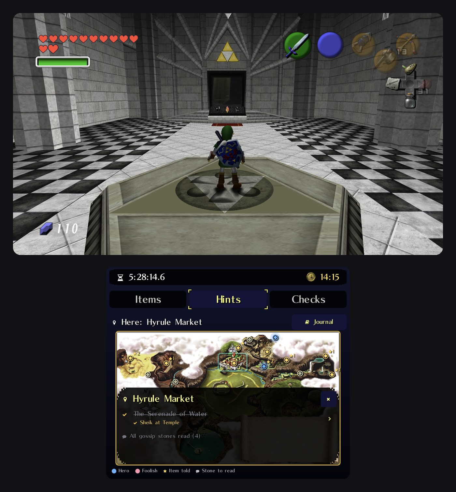
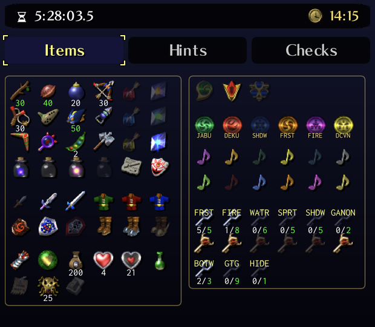
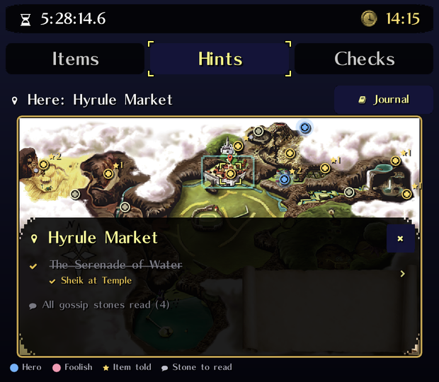
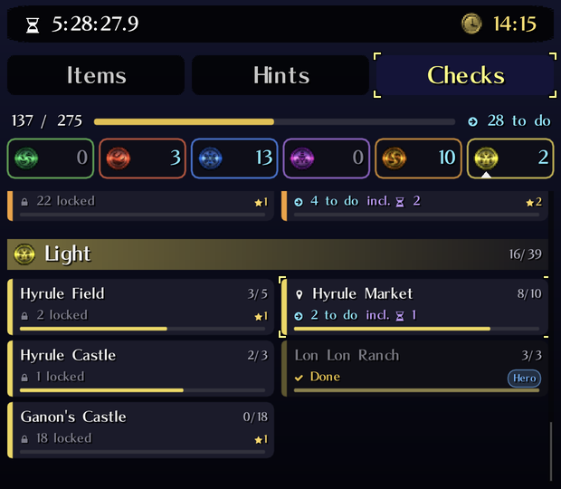
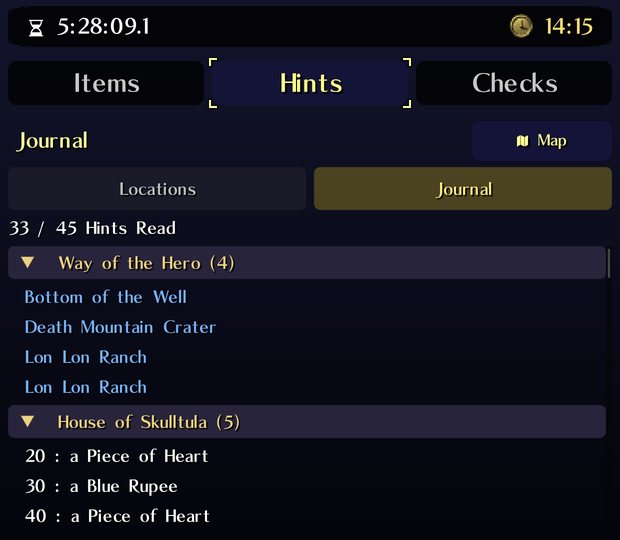
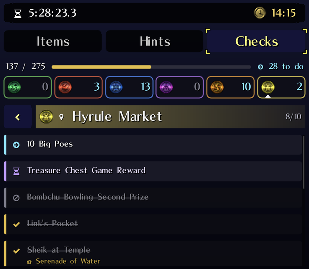

# SoH Dual Screen Rando

Ship of Harkinian build for the AYN Thor, with a rando tracker on the bottom screen.

I play OoT rando on my Thor and I wanted the second screen to actually be useful, so I made this. The game runs on the top screen, and the bottom screen shows your items, a hint map and the list of checks you can do right now (using the rando logic). It uses the game's font and textures, so it doesn't look like an app glued under the game.

Based on SoH 9.3.1 and on Darkaxt's dual screen port.

*Screenshots with the [OoT Reloaded](https://github.com/GhostlyDark/OoT-Reloaded-SoH) HD pack.*

[Download](https://github.com/Dizax-git/Shipwright-Android-Dual-Screen-Bleeding-Edge/releases/latest) · [Install](#install) · [Credits](#credits) · [Français](#français)

## What's on the bottom screen

| Items | Hints | Checks |
| --- | --- | --- |
|  |  |  |

| Hint journal | An area in Checks |
| --- | --- |
|  |  |

At the top there's the run timer and the time of day.

**Items**: SoH's item tracker with the real icons. Once you've read the altar in the Temple of Time, the stones and medallions show which dungeon they're in.

**Hints**: the Hyrule map from the pause menu. Every location you have a hint for gets a marker: Way of the Hero, barren, items still to find, gossip stones you haven't read yet. Tap a location to see what you know about it. Only hints you've actually read show up, so no spoilers. The usual hint journal is still there behind the Journal button.

**Checks**: the checks of your seed, sorted by region (the 6 medallions) and by area. It uses the rando logic and updates every time you get an item:
- blue: you can get it now
- purple with an hourglass: you can get it at the other age
- grey with a lock: not yet
- gold: done

Tap a check to see its full name or skip it. A blinking blue dot shows what just opened up. It can follow Link from area to area.

Touching the bottom screen doesn't take the controls away from the game (on the Thor, also set Autolock to the top screen in the AYN settings).

## Other changes

- All check, area and gossip stone names in French too (English and German keep the original names)
- Bigger SoH menu that works with your finger: scroll by dragging, keyboard for search, Menu Scale slider in Settings > General
- Gyro aiming uses the Thor's own sensor (the built-in controller doesn't expose one), with more settings in Settings > Controls
- Quit really closes the game instead of leaving it in the background
- Fixed unreadable letters on the title screen and invisible chests with Containers Match Contents (64-bit Android bugs)

## Install

You need your own Ocarina of Time ROM. Check that it's supported on [ship.equipment](https://ship.equipment/).

1. If you already have a SoH build with the package `com.dishii.soh` (Darkaxt's port for example), uninstall it first. This one is signed with a different key so Android won't install over it. Your `SOH` folder stays where it is, but back it up anyway.
2. Download the APK from the [releases](https://github.com/Dizax-git/Shipwright-Android-Dual-Screen-Bleeding-Edge/releases/latest) and install it.
3. Start it, allow file access and press OK. The first launch copies its files (v1.0.0 shows a black screen for several minutes during this, just wait; later versions show a counter). Then tap Yes to pick your ROM. It builds `oot.o2r` the first time.
4. On the Thor, set Autolock to the top screen in the AYN settings.
5. Make a seed in the Randomizer menu and start a new file.

If you use the [OoT Reloaded](https://github.com/GhostlyDark/OoT-Reloaded-SoH) HD pack (in `SOH/mods`), the bottom screen uses its HD font.

To update, just install the new APK over the old one. Saves and settings are kept.

Settings are in Enhancements > UI: what the bottom screen shows (trackers or the normal HUD), its size, game font on/off, reachable checks, follow current area, maps and compasses.

The on-screen touch controls are hidden, the Thor has its own buttons. To bring them back: Settings > Controls > Touch Controls, untick "Hide Overlay Toggle Button", then tap the eye.

## Notes

- Android arm64 only. I only tested it on my Thor. Other dual screen handhelds might work if Android sees the second screen as a display.
- Everything else is regular SoH 9.3.1 (rando, enhancements, mods).
- This is not official, please don't bother the Harbour Masters or Darkaxt with issues from this build. Open an [issue](https://github.com/Dizax-git/Shipwright-Android-Dual-Screen-Bleeding-Edge/issues) here.
- I made this with a lot of help from Claude (AI) for the code. I tested everything on my Thor during my own seeds.
- Building: branch `thor-trackers`, the APK is built by GitHub Actions (`.github/workflows/android.yml`). See the [base port's README](docs/android/BASE-PORT-README.md) and [docs/BUILDING.md](docs/BUILDING.md).

## Credits

None of this would exist without:
- [Harbour Masters](https://github.com/HarbourMasters/Shipwright) for Ship of Harkinian, its rando and trackers, [libultraship](https://github.com/Kenix3/libultraship) and [Torch](https://github.com/HarbourMasters/Torch) (full list in [docs/CREDITS.md](docs/CREDITS.md))
- the [OoT decomp](https://github.com/zeldaret/oot) team
- [Darkaxt](https://github.com/Darkaxt/Shipwright-Android-Dual-Screen-Bleeding-Edge) for the dual screen port this is forked from
- [chilhaps](https://github.com/chilhaps/Shipwright-Android-Dual-Screen) for the first dual screen version
- [Waterdish](https://github.com/Waterdish/Shipwright-Android) for the original Android port
- [please-be-nice](https://github.com/please-be-nice/Shipwright-android) for the newer Android work
- [alexbcz](https://github.com/alexbcz/2ship2harkinian-PAL) and [linkzenic](https://github.com/linkzenic/2ship2harkinian-Android) for the touch menu of 2 Ship 2 Harkinian on Android, which I brought over here
- [OoT Randomizer](https://github.com/OoTRandomizer/OoT-Randomizer)
- [Dusk](https://github.com/TwilitRealm/dusk) by TwilitRealm, I copied their gyro settings
- [JoyShockMapper](https://github.com/JibbSmart/JoyShockMapper) by Jibb Smart for the "player space" gyro
- [GhostlyDark and the OoT Reloaded team](https://github.com/GhostlyDark/OoT-Reloaded-SoH) for the HD pack (not included)

Zelda is Nintendo's. No game data in here.

## Français

Une version de Ship of Harkinian pour l'AYN Thor, avec un tracker de rando sur l'écran du bas : objets, carte des indices (sans spoil, seulement ce que vous avez lu) et liste des checks faisables maintenant selon la logique du rando. Tout est dans la police du jeu, et tous les noms de checks sont traduits en français.

Pour l'installer : désinstallez d'abord toute autre version qui utilise `com.dishii.soh` (le dossier `SOH` reste, mais faites une copie), installez l'APK de la [release](https://github.com/Dizax-git/Shipwright-Android-Dual-Screen-Bleeding-Edge/releases/latest), puis choisissez votre ROM au premier lancement. Sur la Thor, mettez Autolock sur l'écran du haut. Les réglages sont dans Enhancements > UI.
